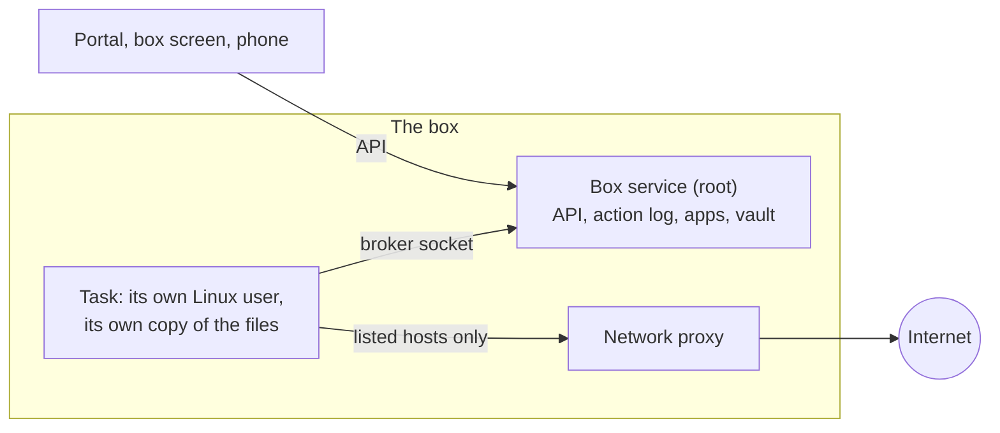

<p align="center"></p>

<h1 align="center">GurtOS</h1>

<p align="center">
  An operating system for AI agents. Agents work on real files, the web and money<br>
  without holding your keys, and you can undo any one task.
</p>

<p align="center">
  <a href="https://github.com/benz16107/gurtos/releases/tag/v0.2.0-preview">Download</a> ·
  <a href="https://gurtos.com/docs/">Docs</a> ·
  <a href="https://youtu.be/rREjU2ddIyo">3-minute video</a> ·
  <a href="release/notes/v0.2.0-preview.md">Release notes</a> ·
  <a href="ROADMAP.md">Roadmap</a>
</p>


GurtOS is Ubuntu 24.04 with a box service that runs every agent task in its own sandbox. You give a task in plain
words. An agent (Factory's Droid, with Claude as the model) does the work, and GurtOS decides what the agent can
touch, which hosts it can reach and what it must ask you first. Everything goes into one log.

> [!WARNING]
> GurtOS is a preview. It installs from its own ISO and runs end to end, but it has not had an outside security
> audit, and the installer erases the whole disk. Use a spare machine or a VM, with test keys.

## What it does

- **Undo one task.** Each task runs as its own Linux user, without sudo, in its own copy of the files. Undo removes
  that task's changes and keeps every other task's.
- **Keep keys away from agents.** Keys live in a vault only root can read. The box adds the model key to the agent's
  calls on the way out, so a page that tells the agent to send its keys somewhere finds nothing to send.
- **Limit where a task can connect.** A task's network reaches only the box's proxy, and the proxy lets through only
  the hosts that task lists. Each refused connection is logged.
- **Ask before it spends.** Spending above a task's budget, or above your approval threshold, pauses the task and
  asks you on the box's screen, the desktop or your phone. Other tasks keep running.
- **Survive a power cut.** When the box starts again, it rebuilds every task from the log and resumes the ones that
  were running.
- **Log everything.** One append-only action log holds every step, tool call, approval, cost and blocked connection.
  Each line carries the hash of the line before it.

## Editions

| Edition | For | What you see |
|---|---|---|
| **Server** | An always-on box at home or in the cloud | The box's own full-screen interface. No desktop, no login prompt, no user with sudo |
| **Personal** | Your own laptop or desktop | Ubuntu's GNOME desktop with your account. Agents work on copies of your folders, and nothing changes in your folders until you choose Keep |
| **Business** (preview) | One box shared by a team | A setting on Server or Personal: roles, approvals routed by a policy in plain words, an audit trail, a kill switch and shadow mode. Off until the owner turns it on |

Server and Personal update as a whole system, and go back to the old system by themselves if an update does not
come up healthy.

## Get started

### 1. Download

The current release is [v0.2.0-preview](https://github.com/benz16107/gurtos/releases/tag/v0.2.0-preview).

| Machine | File | Size |
|---|---|---|
| Server on a PC, server or cloud VM (Intel or AMD) | [`gurtos-server-x86_64.iso`](https://github.com/benz16107/gurtos/releases/download/v0.2.0-preview/gurtos-server-x86_64.iso) | 1.37 GB |
| Server on an Apple silicon Mac (UTM or Parallels) or an arm64 server | [`gurtos-server-arm64.iso`](https://github.com/benz16107/gurtos/releases/download/v0.2.0-preview/gurtos-server-arm64.iso) | 1.36 GB |
| Personal on a PC or laptop (Intel or AMD) | [`gurtos-personal-x86_64.iso`](https://github.com/benz16107/gurtos/releases/download/v0.2.0-preview/gurtos-personal-x86_64.iso) | 2.00 GB |
| Personal on an Apple silicon Mac (UTM or Parallels) | [`gurtos-personal-arm64.iso`](https://github.com/benz16107/gurtos/releases/download/v0.2.0-preview/gurtos-personal-arm64.iso) | 1.99 GB |

You need 2 cores and 4 GB of memory (4 cores and 8 GB recommended), and a whole disk of at least 17 GB for Server or
29 GB for Personal. Turn Secure Boot off. Server needs a wired network. Both need the internet on first start,
because the box downloads Factory's Droid CLI (about 300 MB). Full requirements are in the docs for
[Server](https://gurtos.com/docs/get-started/install-server/) and
[Personal](https://gurtos.com/docs/get-started/install-personal/).

The Mac and Android apps are on the
[v0.1.0-preview release](https://github.com/benz16107/gurtos/releases/tag/v0.1.0-preview).

### 2. Verify it

Download `SHA256SUMS`, `SHA256SUMS.sig` and `allowed_signers` from the release page, then check the signature and
your ISO's checksum. This needs OpenSSH 8.1 or newer.

```sh
ssh-keygen -Y verify -f allowed_signers -I gurtos -n gurtos-release -s SHA256SUMS.sig < SHA256SUMS
# Good "gurtos-release" signature for gurtos with ED25519 key SHA256:FWKFb1eAvEBmMhVJwMwTnLnhrmZ5yQZ5947pDvFKcpY
sha256sum -c SHA256SUMS --ignore-missing        # on macOS: shasum -a 256 -c SHA256SUMS --ignore-missing
```

The same public key is in [`release/allowed_signers`](release/allowed_signers), and its fingerprint is on
[gurtos.com/download](https://gurtos.com/download/).

### 3. Install

1. Write the ISO to a USB stick (balenaEtcher, or `dd`), or attach it to a VM as its CD.
2. Start from it. If the computer has one empty internal disk, the installer uses it straight away. Otherwise it
   lists the disks, and you type `erase` before it overwrites one that holds data. It never offers the stick it
   started from.
3. Follow the setup on the screen. Server asks for its network, name, owner and phone. Personal shows GNOME's
   welcome first, which makes your account, then GurtOS Setup.
4. Add one model key: an [Anthropic API key](https://console.anthropic.com) or a
   [Factory API key](https://app.factory.ai). It goes into the vault, and agents never see it.

A new box turns on only the model app (and Find, the search app, on Personal). Every other app stays off until you
turn it on in App Center. The install docs have step-by-step guides for a real machine, UTM, QEMU and a cloud VM.

### 4. Run a task

Open **Tasks**, choose **New task**, and say what to do. List the hosts it may reach, or leave the list empty to
allow only the model. Set a budget if you like, then choose **Start**. When it is done, open it to see the files it
changed, and choose **Undo task** to take its changes out. On Personal, **Keep** copies its changes into your folder.
The [first task guide](https://gurtos.com/docs/get-started/first-task/) walks through it.

## How it keeps agents in line



| Risk | What GurtOS does |
|---|---|
| A web page tells the agent to steal your keys | Agents never hold a secret. The vault (`/etc/box/vault.env`, root only) holds the keys, and the box makes keyed calls for the agent |
| An agent sends your data somewhere else | The proxy allows only the hosts the task lists. Cloud metadata addresses are never reachable |
| An agent breaks your files | It works in its own copy, as its own user. Undo takes out its changes alone |
| An agent hogs the machine | Each task is a locked-down systemd unit: no capabilities, a system call filter, 2 GB of memory, 512 processes, a private `/tmp`. A task whose copy grows past 5 GB is stopped and undone |
| An agent spends too much | Every tool declares its cost. Above the task's budget or your threshold, the task stops and asks you |
| The power goes out | The box rebuilds every task from the log and resumes the running ones |

What it does not protect against yet:

- Every task shares one Linux kernel, so a kernel bug could reach every task.
- The proxy checks which hosts a task may reach, not what it sends them.
- The 5 GB limit is checked every 2 seconds and once more when a task ends. It is not a hard quota, so a fast writer
  can pass it briefly.
- The disk is not encrypted, and root can read the vault and rewrite the log.

The full model is in the [threat model](https://gurtos.com/docs/security/threat-model/). The attack scoreboard
([tracks/armadin/SCOREBOARD.md](tracks/armadin/SCOREBOARD.md)) lists 41 attacks: 36 caught, and the 5 it does not
cover. Report security problems privately, as [SECURITY.md](SECURITY.md) describes.

## Phones, remote access and updates

Pair a phone by scanning the code on the box's screen from the same network. You can then approve requests from the
phone's browser or the GurtOS apps. To reach the box from outside your network, use a private network such as
Tailscale, or [run your own relay](docs/self-host.md), which also sends push notifications. The hosted relay at
`box.gurtos.com` is offline.

On Personal, `sudo box-update apply <url of a signed .sqfs image>` installs a new system into the spare slot and
restarts into it. If it is not healthy within 5 minutes, the computer goes back to the old one. Server has no shell,
so it is installed again from the new ISO. See [image/README.md](image/README.md#how-updates-work).

## Develop

You need git and Node 22.18 or newer. The box runs its TypeScript directly, with no build step.

```sh
git clone https://github.com/benz16107/gurtos.git && cd gurtos
npm ci && npm ci --prefix portal
npm test                  # unit tests
npm run check             # type check
node release/check.ts     # no keys, machine names or private addresses in committed files
```

The box creates Linux users, firewall rules and services, so never run it on a computer you use. The merge gate,
`./demo`, copies your checkout to an Ubuntu 24.04 VM and runs every check there with a scripted worker, so it needs
no keys:

```sh
BOX_SHELL='ssh my-vm' ./demo
```

To build the install discs, run `image/build` on an Ubuntu 24.04 machine set aside for it (`image/build personal
arm64` and so on). [CONTRIBUTING.md](CONTRIBUTING.md) covers the test VM, the merge gate and pull requests;
[image/README.md](image/README.md) and [release/README.md](release/README.md) cover images and releases.

## What is in this repo

| Folder | What |
|---|---|
| [`core/`](core/README.md) | The box service: tasks, sandbox, proxy, vault, action log and API |
| [`portal/`](portal/README.md) | The web app on the box's screen, in a browser and on a phone |
| [`personal/`](personal/README.md) | The GNOME desktop layer of GurtOS Personal |
| [`image/`](image/README.md) | The install discs, installer, updates and rollback |
| [`tracks/`](tracks/example/README.md) | Apps that plug into the box, one folder each. `tracks/example/` shows every slot |
| [`native/`](native/README.md) | The iPhone, Apple Watch, Mac and Android apps |
| [`relay/`](relay/README.md) | The relay for remote access and push, to run yourself |
| [`release/`](release/README.md) | How releases are built, signed and published, and the licence report |
| `site/` | The docs at [gurtos.com](https://gurtos.com) |
| `showcase/` | The Cal Hacks 13.0 showcase at [calhacks.gurtos.com](https://calhacks.gurtos.com) |
| [`docs/`](docs/README.md) | Design notes and the hackathon's records |

GurtOS started as a weekend project at [Cal Hacks 13.0](https://calhacks.gurtos.com) in October 2026.

## Licence

Apache License 2.0, see [LICENSE](LICENSE). The install discs also contain third-party software under its own
licences, listed in [NOTICE](NOTICE) and [release/licenses.md](release/licenses.md). Factory's Droid CLI is not part
of GurtOS: the box downloads it from Factory on first start, under Factory's terms.
