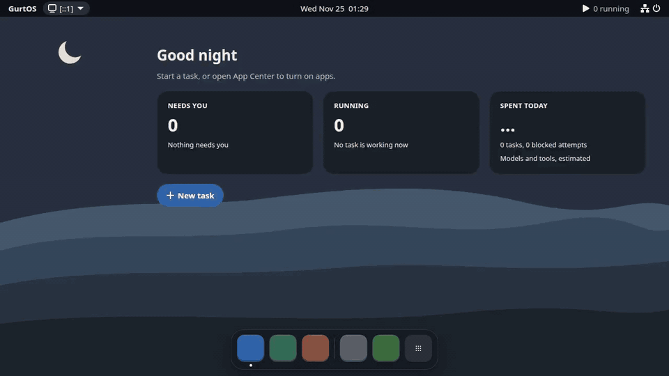
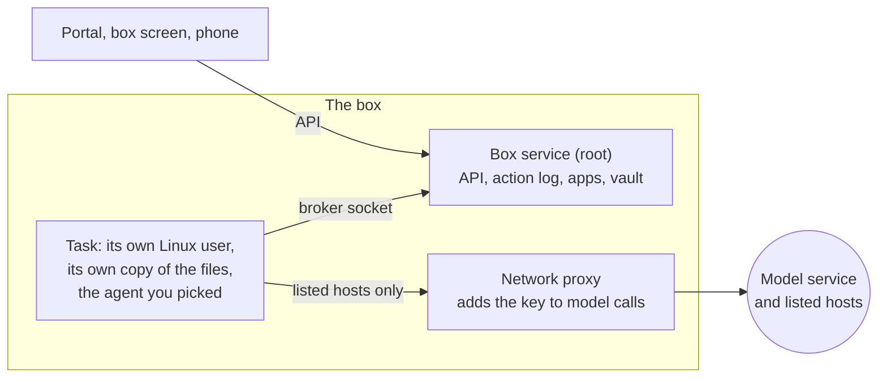

<p align="center"></p>

<h1 align="center">GurtOS</h1>

<p align="center">
  Undo for every agent task, and no API keys inside the agent.
</p>

<p align="center">
  <a href="#install">Install</a> ·
  <a href="https://gurtos.com/docs/">Docs</a> ·
  <a href="https://gurtos.com/download/">Download an ISO</a> ·
  <a href="https://youtu.be/rREjU2ddIyo">3-minute video</a> ·
  <a href="ROADMAP.md">Roadmap</a>
</p>

[](docs/images/demo.mp4)

GurtOS runs coding agents (Claude Code, Codex CLI, opencode, Factory's Droid, or a local model through Ollama) on a
Linux machine you own. Each task runs as its own Linux user, on its own copy-on-write copy of your files, and undo
takes out one task's changes without touching the others. The agent never holds your API key: it gets a
placeholder, and a proxy on the box puts the real key on each model call on the way out. Every step goes into one
hash-chained log.

> [!WARNING]
> GurtOS is a preview. It runs end to end, but it has not had an outside security audit, and its service runs as
> root. Use a VM, a cloud server or a spare machine, with test keys.

## Install

On Ubuntu 24.04, x86_64 or arm64, with sudo and 1 GB of memory or more:

```sh
curl -fsSL https://gurtos.com/install.sh | sh
```

Before it changes anything, it lists what it adds and asks once: a few packages, Node.js if yours is older than 22,
two services, the `gurtos` group, one firewall table that only limits GurtOS's own task users, and ports on
`127.0.0.1` only. It leaves your disk, your users and your files alone. Run it again to update.
`curl -fsSL https://gurtos.com/install.sh | sh -s -- --uninstall` removes everything it added.
[Read the script](install.sh) first if you like; it is one shell function.

It ends by printing how to open the portal: `http://127.0.0.1:7700/` on the machine, or through `ssh -L 7700:127.0.0.1:7700`
from your own computer. On a Mac, run Ubuntu 24.04 in [Lima](https://lima-vm.io) or UTM and install inside it
([steps](https://gurtos.com/download/#mac)).

To install GurtOS as the whole system instead, with a full-screen box interface or a GNOME desktop and updates that
roll back, use an [ISO](#install-the-whole-system-from-an-iso).

## Run a task

1. In the portal, open **Settings, Agents & Models** and add a key: Anthropic, OpenAI, Factory, an Ollama address,
   or your own endpoint. It goes into the vault (`/etc/box/vault.env`, root only). The portal can write a key but
   never shows it again.
2. Open **Tasks**, choose **New task** and say what to do in plain words. Pick the agent, list the hosts it may
   reach (or none, which allows only the model), and set a budget if you like.
3. When it is done, open it to see each file it changed and each step it took. **Undo task** takes its changes out.

The same thing through the API, from the machine:

```sh
curl -X POST http://127.0.0.1:7700/api/tasks -H 'content-type: application/json' -d '{
  "title": "Fix the typos",
  "prompt": "Fix the spelling mistakes in notes.md.",
  "agent": "claude",
  "hosts": []
}'
```

The [first task guide](https://gurtos.com/docs/get-started/first-task/) walks through it with screenshots.

## Agents

GurtOS installs the agent you pick the first time a task asks for it, at a pinned version
([`core/workers/index.ts`](core/workers/index.ts)).

| Agent | Model services | Asks you before a risky shell command |
|---|---|---|
| Claude Code | Anthropic, Ollama, any Anthropic-format endpoint | Yes |
| Codex CLI | OpenAI, Ollama, any endpoint that serves OpenAI's Responses API | Not yet |
| opencode | Anthropic, OpenAI, Ollama, either format | Not yet |
| Factory Droid | Factory, Anthropic | Yes |

Each agent's model address points at the box's proxy, and its key is a placeholder. The proxy passes on model calls
only, and refuses a call that asks the model service to search or fetch the web from its own side, because those
requests would leave from the service and the task's host list could not hold them. A claude.ai or ChatGPT
subscription login does not work: there is no way to hand it to a task without the task holding it.
[Choose your agent](https://gurtos.com/docs/guides/choose-your-agent/) has the details for each one.

## What it does

- **Undo one task.** Each task runs as its own Linux user, without sudo, in its own overlay copy of the files. Undo
  removes that task's changes and keeps every other task's.
- **Keep keys away from agents.** Keys live in a vault only root can read. A web page that tells the agent to send
  its keys somewhere finds a placeholder.
- **Limit where a task can connect.** A task's network reaches only the box's proxy, and the proxy lets through only
  the hosts that task lists. The firewall drops anything that goes around the proxy. Each refused connection is
  logged.
- **Ask before it spends.** A step above the task's budget, or above your approval threshold, pauses that task and
  asks you on the portal, the box's screen or your phone. Other tasks keep running.
- **Survive a power cut.** When the box starts again, it rebuilds every task from the log and resumes the ones that
  were running.
- **Log everything.** One append-only log holds every step, tool call, approval, cost and blocked connection. Each
  line carries the SHA-256 of the line before it.

## How it differs

| | A plain container or VM | Docker Sandboxes | NVIDIA OpenShell | GurtOS |
|---|---|---|---|---|
| Isolation | The container or VM | A microVM per sandbox | Landlock, seccomp and a network namespace | A Linux user and a locked systemd unit per task |
| Agent holds the API key | Up to you | No, a host proxy adds it | No, added at approved endpoints | No, the box's proxy adds it |
| Outbound hosts | None built in | Denied unless allowed | A policy check on every connection | Only the hosts each task lists |
| Undo | A VM snapshot, if you took one | Clone mode works on a private copy | Not documented | Per task, without touching other tasks |
| Human approval | None | Not documented | For risky policy changes | For spending over a budget, on screen or phone |
| Record of actions | None | Not documented | Telemetry only | A hash-chained log of every event |

"Not documented" means we read the product's docs on November 24, 2026 and did not find it:
[Docker Sandboxes security](https://docs.docker.com/ai/sandboxes/security/),
[NVIDIA OpenShell](https://github.com/NVIDIA/OpenShell). Corrections are welcome as an issue.

## How it keeps agents in line



| Risk | What GurtOS does |
|---|---|
| A web page tells the agent to steal your keys | The agent holds a placeholder. The vault is root only, and the proxy adds the key outside the task |
| An agent sends your data somewhere else | The proxy allows only the hosts the task lists. Cloud metadata addresses are never reachable |
| An agent breaks your files | It works in its own copy, as its own user. Undo takes out its changes alone |
| An agent approves its own request | It cannot reach the box's API or its database, and only the owner can answer |
| An agent hogs the machine | Each task is a locked-down systemd unit: no capabilities, a system call filter, 2 GB of memory, 512 processes, a private `/tmp`. A task whose copy grows past 5 GB is stopped and undone |
| An agent spends too much | Every tool declares its cost. Above the task's budget or your threshold, the task stops and asks you |
| The power goes out | The box rebuilds every task from the log and resumes the running ones |

The merge gate runs 41 OS-level attacks against a real box on every change to the core: 36 are caught, and
[the scoreboard](tracks/attacks/SCOREBOARD.md) names the 5 it does not cover.

## Limits

- Every task shares one Linux kernel, so a kernel bug could reach every task.
- The proxy checks which hosts a task may reach, not what it sends them.
- Undo covers files. It cannot recall a message or a payment a task already sent; those calls are in the log.
- Codex and opencode do not ask before a shell command. Their limits are the task's user, its copy of the files and
  its host list.
- The 5 GB disk limit is checked every 2 seconds and once more when a task ends, so a fast writer can pass it briefly.
- The disk is not encrypted. Root can read the vault and rewrite the log, and the box does not check the log's chain
  for you yet.

The full model is in the [threat model](https://gurtos.com/docs/security/threat-model/). Report security problems
privately, as [SECURITY.md](SECURITY.md) describes.

## Install the whole system from an ISO

| Edition | For | What you see |
|---|---|---|
| **Server** | An always-on box at home or in the cloud | The box's own full-screen interface. No desktop, no login prompt, no user with sudo |
| **Personal** | Your own laptop or desktop | Ubuntu's GNOME desktop with your account. Agents work on copies of your folders, and nothing changes in your folders until you choose Keep |
| **Business** (preview) | One box shared by a team | A setting on Server or Personal: roles, approvals routed by a policy in plain words, an audit trail, a kill switch and shadow mode. Off until the owner turns it on |

The ISO installer **erases the disk it installs to**. The current release is
[v0.2.0-preview](https://github.com/benz16107/gurtos/releases/tag/v0.2.0-preview):

| Machine | File | Size |
|---|---|---|
| Server on a PC, server or cloud VM (Intel or AMD) | [`gurtos-server-x86_64.iso`](https://github.com/benz16107/gurtos/releases/download/v0.2.0-preview/gurtos-server-x86_64.iso) | 1.37 GB |
| Server on an Apple silicon Mac (UTM or Parallels) or an arm64 server | [`gurtos-server-arm64.iso`](https://github.com/benz16107/gurtos/releases/download/v0.2.0-preview/gurtos-server-arm64.iso) | 1.36 GB |
| Personal on a PC or laptop (Intel or AMD) | [`gurtos-personal-x86_64.iso`](https://github.com/benz16107/gurtos/releases/download/v0.2.0-preview/gurtos-personal-x86_64.iso) | 2.00 GB |
| Personal on an Apple silicon Mac (UTM or Parallels) | [`gurtos-personal-arm64.iso`](https://github.com/benz16107/gurtos/releases/download/v0.2.0-preview/gurtos-personal-arm64.iso) | 1.99 GB |

You need 2 cores and 4 GB of memory (4 cores and 8 GB recommended), a whole disk of at least 17 GB for Server or
29 GB for Personal, and Secure Boot off. Server needs a wired network. Both need the internet on first start, to
download the agents. Check the download first (OpenSSH 8.1 or newer), with `SHA256SUMS`, `SHA256SUMS.sig` and
`allowed_signers` from the release page:

```sh
ssh-keygen -Y verify -f allowed_signers -I gurtos -n gurtos-release -s SHA256SUMS.sig < SHA256SUMS
# Good "gurtos-release" signature for gurtos with ED25519 key SHA256:FWKFb1eAvEBmMhVJwMwTnLnhrmZ5yQZ5947pDvFKcpY
sha256sum -c SHA256SUMS --ignore-missing        # on macOS: shasum -a 256 -c SHA256SUMS --ignore-missing
```

The same public key is in [`release/allowed_signers`](release/allowed_signers). Then write the ISO to a USB stick
or attach it to a VM, start from it, and follow the setup on the screen. The docs have step-by-step guides for
[Server](https://gurtos.com/docs/get-started/install-server/) and
[Personal](https://gurtos.com/docs/get-started/install-personal/), on a real machine, UTM, QEMU and a cloud VM.

Server and Personal update as a whole system, and go back to the old system by themselves if an update does not
come up healthy within 5 minutes ([how updates work](image/README.md#how-updates-work)). Pair a phone by scanning
the code on the box's screen. To reach the box from outside your network, use a private network such as Tailscale,
or [run your own relay](docs/self-host.md). There is no hosted relay. The Mac and Android apps are on the
[v0.1.0-preview release](https://github.com/benz16107/gurtos/releases/tag/v0.1.0-preview).

## Contribute

Issues and pull requests are welcome. Issues labelled
[good first issue](https://github.com/benz16107/gurtos/issues?q=is%3Aissue+is%3Aopen+label%3A%22good+first+issue%22)
are small and self-contained. You need git and Node 22.18 or newer; the box runs its TypeScript directly, with no
build step.

```sh
git clone https://github.com/benz16107/gurtos.git && cd gurtos
npm ci && npm ci --prefix portal
npm test                  # unit tests, a few seconds
npm run check             # type check
node release/check.ts     # no keys, machine names or private addresses in committed files
```

The box creates Linux users, firewall rules and services, so never run it as root on a computer you use. The merge
gate, `./demo`, copies your checkout to an Ubuntu 24.04 VM and runs the four demo moments, the attack scoreboard and
every app's checks there, with a scripted agent, so it needs no keys:

```sh
BOX_SHELL='limactl shell --workdir / gurtos --' ./demo
```

[CONTRIBUTING.md](CONTRIBUTING.md) covers the test VM, the merge gate, sign-off (DCO) and pull requests.

| Folder | What |
|---|---|
| [`core/`](core/README.md) | The box service: tasks, sandbox, proxy, vault, action log and API. Start here |
| [`core/workers/`](core/workers/index.ts) | One file per agent: how it is installed, started and pointed at the proxy |
| [`portal/`](portal/README.md) | The web app on the box's screen, in a browser and on a phone |
| [`tracks/`](tracks/example/README.md) | Apps that plug into the box, one folder each. `tracks/example/` shows every slot |
| [`personal/`](personal/README.md) | The GNOME desktop layer of GurtOS Personal |
| [`image/`](image/README.md) | The install discs, installer, updates and rollback |
| [`native/`](native/README.md) | The iPhone, Apple Watch, Mac and Android apps |
| [`relay/`](relay/README.md) | The relay for remote access and push, to run yourself |
| [`release/`](release/README.md) | How releases are built, signed and published, and the licence report |
| `site/` | The docs at [gurtos.com](https://gurtos.com) |
| [`docs/`](docs/README.md) | Design notes |

GurtOS started as a weekend project at Cal Hacks 13.0 in October 2026. The hackathon's sponsor apps live at the tag
[`calhacks-2026`](https://github.com/benz16107/gurtos/tree/calhacks-2026/tracks).

## Licence

Apache License 2.0, see [LICENSE](LICENSE). The install discs also contain third-party software under its own
licences, listed in [NOTICE](NOTICE) and [release/licenses.md](release/licenses.md). The agents are not part of
GurtOS: the box downloads each one from its publisher (npm, or Factory for Droid) under that publisher's terms.
